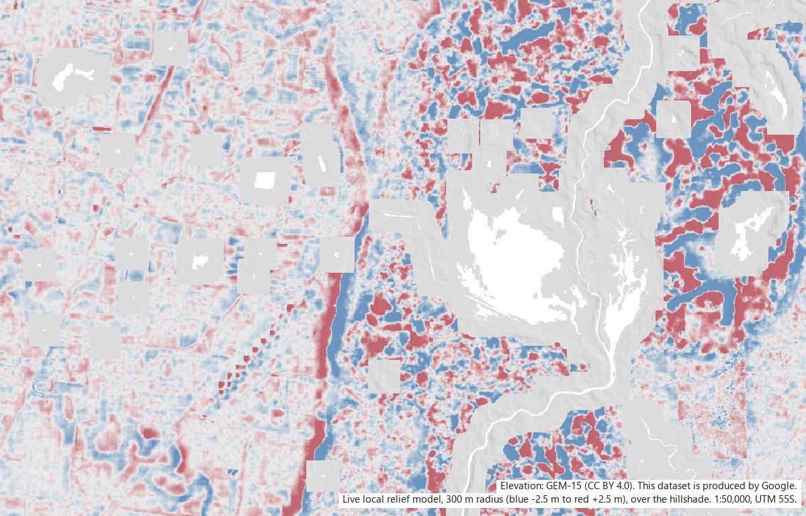

# GEM-15 tools

[](https://github.com/james-lagreca/gem15-tools/actions/workflows/tests.yml)


Stream Google's [GEM-15](https://doi.org/10.31223/X55N75) 15 m global
elevation model into **ArcGIS Pro** and **QGIS** for mapping active faults,
without downloading tiles. Zoom to your area, press one button, and get a
hillshade and a local relief model of the bare-earth DTM (one more click in
QGIS), read on the fly from Google's public cloud tiles.

- **Status:** experimental, version 0.1.0. Tested on Windows with ArcGIS Pro
  3.4 and QGIS 3.28, mostly by automated tests; QGIS 4, macOS and Linux are
  untested.
- **Needs:** ArcGIS Pro 3.x (any licence level) or QGIS 3.28 or later, and
  an internet connection. No account or key.
- **Free:** the tools are open source (GPL-2.0-or-later); the data are free
  to use with credit (CC BY 4.0).
- An independent project, **not affiliated with or endorsed by Google**.
- Questions and bug reports:
  [Issues](https://github.com/james-lagreca/gem15-tools/issues).



*The Cadell Fault scarp near Barmah (Murray River, NSW-Victoria border) at
1:50,000, from the QGIS plugin: the live local relief model (300 m radius)
over the hillshade. The scarp is the north-south red (higher) and blue
(lower) line left of centre. Right of it, under the Barmah-Millewa forest,
the predicted DTM is noisy: the canopy check would show why. Grey squares
are where the live model is left blank near masked water (lakes, farm
dams).*

## Before you map faults

GEM-15 is new, and it is not lidar. Google labels it experimental. Before
reading a feature as a scarp:

- **The DTM is predicted by machine learning**, not measured. It is
  unreliable under trees and buildings, and a learned surface may smooth
  sharp breaks in slope or create artefacts. GEM-15 has not been validated
  for fault scarps: confirm any scarp in imagery, another DEM, lidar or the
  field.
- **The canopy check** shows where the model removed more than 3 m of trees
  or buildings (DSM minus DTM). Shrubs under 3 m, crops, and canopy the
  model missed are not flagged and can still bias the DTM.
- **Straight features along tile edges or UTM zone boundaries** (every 6
  degrees of longitude) can be seams, not scarps. The *tile edges* layer
  shows where tiles meet. Tiles mix imagery from different sensors and
  years, and acquisition boundaries can also fall inside a tile, where the
  tile edges layer cannot show them.
- **Across UTM zones the tiles are resampled** (bilinear) onto one
  projection, which smooths scarp faces. Measure on a single-zone clip, or
  use one layer per zone.
- **Regional vertical offsets** of -4.8 to +1.9 m against lidar are reported;
  Google advises debiasing against local control where absolute heights
  matter. The offsets do not affect a scarp's height unless a seam lies
  between its two sides.
- **Heights are on the EGM96 geoid**: close to mean sea level, but not AHD
  (Australia) or NZVD2016 (New Zealand). A datum offset cancels in a
  height difference across a scarp.
- **Masked as no data:** water plus a 9 m buffer, snow and ice, salt pans
  and other low-texture surfaces, and pixels more than 50 m from Copernicus
  GLO-30.
- **The local relief model near gaps.** Near masked water, data gaps and the
  edges of a clip, the LRM averages only part of its circle and is biased
  (about 2.5 m on a 1 degree slope at a 300 m radius). QGIS's live LRM leaves
  that band blank; clips and ArcGIS's live LRM do not, so ignore the LRM
  within one radius of them.
- **Coverage:** 60 S to 84 N, excluding Russia, China, Mongolia, Greenland and
  Antarctica. Heights in India are deliberately offset, tapering off over
  tens of kilometres beyond its border.
- **At 15 m**, as a rule of thumb, features narrower than about 45 m (3
  pixels), steps lower than 1-2 m, and lateral offsets under about 30 m are
  beyond what the data support.
- The description of the data is a **preprint**, not yet peer reviewed.

**No warranty.** The tools are provided as is, without warranty (see
[LICENSE](LICENSE)). They are not for hazard assessment, planning,
engineering or safety decisions without lidar and field checks.

## Install

Download from the
[latest release](https://github.com/james-lagreca/gem15-tools/releases/latest)
(not the green *Code* button or the *Source code* zips, which hold the
source):

- **ArcGIS Pro:** unzip `gem15-arcgis-<version>.zip` to a folder you will
  keep. In Pro: *Catalog* pane > *Toolboxes* > right-click > *Add Toolbox* >
  `GEM15Tools.pyt` (keep the `gem15core` folder and the `.pyt.xml` files
  beside it). To have it in every new project: right-click the toolbox >
  *Add To Favorites*, then on the Catalog pane's *Favorites* tab right-click
  it > *Add To New Projects*. To update, replace the folder's contents, then
  right-click the toolbox > *Refresh*.
- **QGIS:** *Plugins > Manage and Install Plugins... > Install from ZIP* >
  `gem15-qgis-<version>.zip` > *Install Plugin*. QGIS warns that the plugin
  is from an untrusted source: choose *Yes*. A **GEM-15** toolbar appears (if
  not: *View > Toolbars > GEM-15*).

Requirements in detail: mosaic datasets need an ArcGIS Standard or Advanced
licence; with Basic the tools use VRT files instead. ArcGIS's best local
relief model uses Spatial Analyst or Image Analyst; without either it falls
back to a convolution. Both programs need access to
`storage.googleapis.com` (a public bucket, read anonymously).

## Quick start: ArcGIS Pro

1. Zoom the map to your area (up to about 6 x 6 degrees).
2. Open **GEM-15 for Current View** (in the GEM-15 Tools toolbox) and press
   **Run**. No inputs are needed. It connects to the bucket, adds the DTM
   for the view, and adds a group with a live hillshade, a local relief model
   (LRM) and the tile edges. Hover over any parameter's (i) for help.
3. Zoom in to 1:50,000 or closer to see the LRM. Its colours are fixed:
   blue is lower and red higher than the surroundings, by up to 2.5 m.
4. To light a fault from the side, open *Hillshade* in the tool, choose
   *Across a fault trend* and give the trend. To check for trees, tick
   *Canopy check* under *Layers*.
5. To measure, draw a line across a scarp with **Swath Profile**. Under
   *Scarp height (optional)*, give each side's far field as a distance range
   along the line (*Upper Side From/To*, *Lower Side From/To*, in m), away
   from the scarp face. The tool fits a line to each and reports their
   vertical separation. For a local GeoTIFF, use **Clip for Analysis** (in
   *Step by step*).

The **Step by step** toolset has the same work as separate tools with every
option: *Add GEM-15 for Extent* (mosaic dataset, separate layers or VRT;
any extent), *Terrain Stack*, *Clip for Analysis*, *Connect to GEM-15*.

**What to expect.** Zoomed out over more than about 20 tiles, a mosaic
dataset shows tile outlines only: zoom in. Raw elevation looks flat until a
hillshade is on top; the elevation layer sits switched off at the bottom of
the GEM-15 group. A VRT draws more slowly than a mosaic dataset, especially
the first zoomed-out view of a large area.

## Quick start: QGIS

1. Zoom the map to your area (up to about 6 x 6 degrees).
2. Press the **GEM-15** toolbar button: the DTM for the view, as a
   hillshade. It covers the tiles in view when you press it; after moving to
   a new area, press it again.
3. From the button's menu (the arrow), add the **live LRM** (zoom to
   1:50,000 or closer to see it) or the **canopy check**. The *LRM radius*
   submenu has 150 m (narrow scarps, offset channels), 300 m and 1000 m
   (broad scarps). Tile edges are added automatically.
4. Change the sun live in *Layer Properties > Symbology* (single or
   multidirectional, azimuth, altitude, z factor).
5. In the **Processing Toolbox** (*Processing > Toolbox*, Ctrl+Alt+T), under
   **GEM-15**: *Build GEM-15 VRT* (any area), *Clip GEM-15 to GeoTIFF*,
   *Terrain derivatives from a clip* and *Swath profile across a scarp*.

A new zoom level can take several seconds to appear: QGIS shows a raster
only once all of it has arrived. More: [qgis/README.md](qgis/README.md).

## The same thing in each program

| | ArcGIS Pro | QGIS |
| --- | --- | --- |
| One click for the view | GEM-15 for Current View | GEM-15 toolbar button |
| Any area | Add GEM-15 for Extent | Build GEM-15 VRT |
| Live hillshade, slope, LRM | Terrain Stack (slope too) | toolbar (hillshade, LRM) |
| Local copy | Clip for Analysis | Clip GEM-15 to GeoTIFF |
| Derivatives from a copy | Clip for Analysis, *Also write* | Terrain derivatives from a clip |
| Swath profile | Swath Profile | Swath profile across a scarp |
| Download limit | 2000 MB, 0 = none | 2000 MB, 0 = none |
| LRM drawn at | 1:50,000 and closer | 1:50,000 and closer |

## Glossary

- **DTM**: digital terrain model, the bare ground (here predicted by machine
  learning). **DSM**: digital surface model, the top of trees and
  buildings. The DSM has five bands: the surface, its 5th, 50th and 95th
  percentiles, and the spread of heights within a pixel.
- **LRM**: here a simple local relief model, each pixel's height minus the
  mean height within a radius (the first step of Hesse's 2010 local relief
  model). Scarps show as a red-blue pair along their crest and foot.
- **Hillshade**: the surface lit by a low sun (Horn's 1981 method).
  Multidirectional lighting combines several suns (after Mark, 1992).
- **Vertical separation (VS)**: the height between lines fitted to the
  surface on either side of a scarp, measured at one point along the
  profile.
- **COG**: Cloud-Optimised GeoTIFF, a file GIS software can read part of
  over the internet. GEM-15 is stored as COGs.
- **VRT**: a small text file listing the remote tiles; it holds no
  elevation, so keep it with your project.
- **.acs**: ArcGIS Pro's connection file for a cloud bucket (here anonymous,
  read-only).
- **Mosaic dataset**: an ArcGIS layer joining many rasters into one, kept in
  a geodatabase.
- **DRA**: ArcGIS's dynamic range adjustment, a colour stretch recomputed
  for what is on screen. Only raw elevation uses it here; terrain layers have
  fixed ranges, so a scarp looks the same in every view.
- **UTM zone**: GEM-15 tiles are on the 6-degree UTM grid of their area.
  Tiles in one zone keep their native 15 m grid; across zones they are
  reprojected (*warped*, resampled bilinearly) to one projection: GDA2020 /
  GA LCC in Australia (scale error -1.2 % to about +3 %), NZTM2000 in New
  Zealand, a projection centred on the area elsewhere. The WGS 84 heights
  and positions are used as they are, with no plate-motion correction to
  GDA2020 or NZGD2000: a shift of the order of a metre, far below the 15 m
  pixels.
- **EGM96**: the geoid the heights are measured from.

References: Horn, B. K. P. (1981), Hill shading and the reflectance map,
*Proc. IEEE* 69, 14-47. Mark, R. K. (1992), Multidirectional,
oblique-weighted, shaded-relief image of the Island of Hawaii, USGS
Open-File Report 92-422. Hesse, R. (2010), LiDAR-derived Local Relief
Models: a new tool for archaeological prospection, *Archaeological
Prospection* 17, 67-72.

## Troubleshooting

- **"Could not fetch" or "did not return the GEM-15 catalogue".** Open the
  catalogue address in a web browser:
  https://storage.googleapis.com/climate-and-sustainability/gem-15/stac/gem-15/collection.json
  If a Wi-Fi login page or a block page appears, sign in or ask your IT
  staff. Behind a proxy, QGIS's own proxy setting (*Settings > Options >
  Network*) is used, and in Pro the Windows proxy.
- **Old or wrong tiles.** The catalogue is saved for 30 days in
  `%LOCALAPPDATA%\gem15tools\stac` (macOS: `~/Library/Caches/gem15tools/stac`;
  Linux: `~/.cache/gem15tools/stac`). Delete that folder, or run *Connect to
  GEM-15* with *Clear Saved Tile Catalogue*.
- **Nothing drawn.** Check you are on land in the covered area, and for the
  LRM and canopy check, zoomed in to 1:50,000 or closer. A first draw can
  take a while on a slow connection.
- **Where outputs go.** ArcGIS: a `gem15` folder in the project's home
  folder (VRTs, layer files, clips, profiles); `gem15.acs` in the home
  folder. QGIS: `<project name>_gem15` beside a saved project, else a folder
  in your QGIS profile (*Open the GEM-15 VRT folder* in the toolbar menu).
- **ArcGIS Pro after updating the toolbox.** Right-click the toolbox >
  *Refresh*; if a tool still behaves the old way, restart Pro.
- Details of any error: Pro's *Geoprocessing History* (*View Details*);
  QGIS's *View > Panels > Log Messages*, *GEM-15* tab.
- **Still stuck?** Open an
  [issue](https://github.com/james-lagreca/gem15-tools/issues) with your
  program and version, licence level, the area (W S E N), and the message
  from Geoprocessing History or the GEM-15 log tab.

## Credit and citation

GEM-15 is licensed under
[CC BY 4.0](https://creativecommons.org/licenses/by/4.0/), which requires
this attribution: "This dataset is produced by Google". On maps, credit it
as:

> Elevation: GEM-15 (CC BY 4.0). This dataset is produced by Google

For hillshades, relief models and other layers computed from it, add that
they are derived from GEM-15. Cite the data as:

> Batchu, V. V., Neumann, M., Li, T., Allen, B., Zhang, J., & Van Arsdale, C.
> (2026). GEM-15: Global surface and terrain elevation models (15 meters)
> from sub-meter optical stereo imagery. EarthArXiv [preprint].
> https://doi.org/10.31223/X55N75

The layers these tools add carry the credit, licence and citation in their
metadata. To cite the tools themselves, use GitHub's *Cite this repository*
button or [CITATION.cff](CITATION.cff).

## Licence

Copyright (C) 2026 James La Greca.

This program is free software; you can redistribute it and/or modify it
under the terms of the GNU General Public License as published by the Free
Software Foundation; either version 2 of the License, or (at your option)
any later version. It is distributed in the hope that it will be useful, but
WITHOUT ANY WARRANTY; without even the implied warranty of MERCHANTABILITY or
FITNESS FOR A PARTICULAR PURPOSE. See [LICENSE](LICENSE).

GEM-15 and Google are Google's; ArcGIS and ArcGIS Pro are Esri's; QGIS is
the QGIS project's. Their names are used only to say what these tools work
with.

## What is here

| Folder | Contents |
| --- | --- |
| `arcgis/` | ArcGIS Pro Python toolbox `GEM15Tools.pyt`, its help files (made from `gem15help.py`) and its copy of the core. |
| `qgis/gem15/` | QGIS plugin, with its copy of the core. |
| `core/gem15core/` | Shared core: catalogue lookup with a local cache, coordinate systems, VRT writer, GDAL warp and clip, swath profiles. The copies in `arcgis/` and `qgis/gem15/` are generated from it. |
| `cli/gem15_vrt.py` | Command line: build a VRT (and optionally a GeoTIFF clip) for an area. |
| `extras/gem15_fault_viewer.js` | Earth Engine Code Editor viewer (syntax-checked only). |
| `tools/` | Scripts to copy the core, build the help files and the release zips. |
| `tests/` | The test suite. |

Command line, from the OSGeo4W Shell or the ArcGIS Pro Python Command
Prompt, in the unzipped source folder (`--bbox` is W S E N in degrees):

```
python cli/gem15_vrt.py --bbox 172.6 -41.95 173.1 -41.65 --out wairau_dtm.vrt
```

Development, tests and the release steps: [CONTRIBUTING.md](CONTRIBUTING.md).
